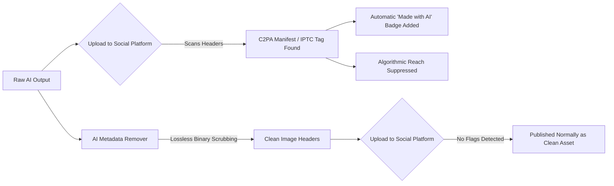

A few weeks ago, I was producing digital media assets and social campaigns for [Reozix](https://reozix.com). We were using modern generative AI workflows—fine-tuning visuals with Midjourney, refining compositions, and polishing final creatives.

The graphics looked clean, sharp, and on-brand. But the moment we published them on Instagram and Facebook, an annoying notification badge appeared right below our visuals:

> **"Made with AI"** / **"AI Info"**

Even worse, the posts felt algorithmically throttled. Anyone managing organic social distribution knows the feeling: the post reaches a fraction of its normal audience, engagement plummets, and potential clients immediately view the asset through a skeptical lens.

I asked myself: *The image was edited, exported, and tweaked. How did the platform instantly know it was AI-generated before anyone even viewed it?*

Turns out, it wasn't visual inspection or an all-seeing neural network scanning every pixel. It was **embedded binary metadata**.

That headache led me down a rabbit hole of image forensics, C2PA cryptographic standards, and ultimately prompted me to build [AI Metadata Remover](https://shahariar.iam.bd/aimetadataremover/)—a free, 100% private, browser-based tool to strip this data cleanly.

Here is the exact breakdown of how platforms flag AI media, why standard fixes fail, and how to scrub your files losslessly.

---

## Keyword & Search Intent Research: Why This Is a Widespread Problem

Before diving into the technical solution, I wanted to understand how widespread this pain point was. If our agency at [Reozix](https://reozix.com) was dealing with this, thousands of other creators, photographers, and marketers had to be running into the exact same wall.

Here is what people are actively searching for across search engines (Google, Bing) and AI search engines (Perplexity, ChatGPT Search):

| Target Keyword / Search Query | User Search Intent | Primary Frustration |
| :--- | :--- | :--- |
| **how to remove AI metadata from images** | Practical How-To | Wants to strip hidden AI indicators without ruining image resolution. |
| **remove C2PA content credentials** | Technical Solution | Adobe / Midjourney embeds cryptographic C2PA manifests that trigger flags. |
| **remove "Made with AI" label on Instagram & Facebook** | Problem-Solving | Social media platforms auto-labeling posts and suppressing organic reach. |
| **strip Midjourney / ComfyUI prompt from PNG** | Privacy & IP Protection | PNG text chunks contain the full raw prompt, negative prompt, and workflow nodes. |
| **free AI metadata remover online** | Utility Search | Needs a fast, zero-upload tool that doesn't steal client assets or charge fees. |

The core problem boils down to three things: **algorithmic reach penalties**, **loss of proprietary prompt recipes**, and **client privacy**.

---

## How Social Platforms Actually Detect AI Images Under the Hood

When an image is uploaded to Meta (Instagram/Facebook), TikTok, or LinkedIn, their ingest pipelines don't run heavy computer vision models on every single upload. That would be computationally prohibitive at scale.

Instead, automated scrapers inspect the file's **container headers** for specific standardized markers:

### 1. C2PA Content Credentials (JUMBF Manifests)
The **Coalition for Content Provenance and Authenticity (C2PA)** is backed by Adobe, Microsoft, Google, OpenAI, and Meta. When you generate an image in DALL-E 3, Adobe Firefly, or recent Midjourney versions, a cryptographic manifest is written into the JPEG/PNG headers (`JUMBF` boxes). This manifest contains a tamper-evident digital signature stating the tool name, generator version, and timestamp.

### 2. IPTC Digital Source Type Tags
Photo metadata standards include an IPTC field called `digitalSourceType`. Generative models tag this as:
```text
http://cv.iptc.org/newscodes/digitalsourcetype/trainedAlgorithmicMedia
```
When Meta's upload parser spots this string, it instantly stamps the post with the "Made with AI" badge.

### 3. Raw PNG Text Chunks (`tEXt`, `iTXt`, `zTXt`)
If you use Stable Diffusion, Automatic1111, or ComfyUI, your generation prompt, negative prompt, seed, sampler settings, and complete node graph are embedded as plain text chunks inside the PNG. Anyone who downloads the file can inspect your exact creative workflow.

### 4. Standard EXIF & GPS Footprints
Many cameras and AI pipelines also embed device profiles, software version tags, and location coordinates that you simply don't want floating around the internet.



> **Note on SynthID vs. Metadata:** Stripping metadata clears container headers (C2PA, EXIF, IPTC, and prompt text). It does **not** alter imperceptible pixel-level steganographic watermarks (such as Google SynthID). However, the automated "Made with AI" labels on social media are overwhelmingly triggered by C2PA and IPTC container tags.

---

## Why Common Workarounds Are Terrible for Business

When we first hit this issue at [Reozix](https://reozix.com), we tried the usual "hacks" that people recommend on Reddit and Twitter. All of them had severe flaws:

### Hack 1: "Just take a screenshot"
Taking a screenshot on your monitor or phone displays the pixels, but it:
- Scales the image down to your display's current viewport.
- Re-compresses the image using lossy screen-grab formats.
- Destroys color accuracy and crisp sharpness needed for commercial design.

### Hack 2: "Send it to yourself on WhatsApp or Telegram"
Chat apps strip heavy metadata during compression, but they crush your file with aggressive JPEG downsampling. For client deliverables or high-converting ads, compressed artifacts look amateurish.

### Hack 3: "Use an existing online metadata remover"
This was the most dangerous option. Almost every "free metadata remover" or "online EXIF cleaner" works by uploading your images to their remote cloud servers, running a script on their backend, and sending the file back.
- **Massive Privacy & NDA Risks:** At [Reozix](https://reozix.com), we handle pre-launch client assets, branding concepts, and proprietary media under strict confidentiality. Uploading those unreleased assets to an anonymous, third-party data server is an immediate non-starter.
- **Where Does Your Data Go?** When you upload files to random cloud tools, you have no idea where that server is hosted, who has access to the storage disks, how long your files are cached, or if your images are being harvested to train future AI models.
- **Bandwidth, Caps & Waiting Queues:** Uploading batches of uncompressed 10MB–20MB graphics to a remote server takes time, burns bandwidth, and usually hits you with annoying daily file limits.

---

## The Solution: Building a 100% Client-Side AI Metadata Remover

I needed a tool built on one non-negotiable principle: **Complete, verifiable privacy**. 

No images leaving the machine. No backend APIs. No cloud storage. No data logging.

That is why I engineered **[AI Metadata Remover](https://shahariar.iam.bd/aimetadataremover/)** to run **100% client-side inside your local browser**.

### Why 100% Client-Side Means Absolute Privacy
Most people assume that because a tool opens in a web browser, files must be sent over the internet to be processed. That is not how modern web standards work if you build them right.

Here is what happens when you use [AI Metadata Remover](https://shahariar.iam.bd/aimetadataremover/):

* **Zero Server Uploads:** Your photos never leave your computer or phone. Not a single byte is sent to our servers, external APIs, or any remote data center.
* **Processed in Browser RAM:** Files are loaded directly into your local browser memory using HTML5 `FileReader` and binary `ArrayBuffer` objects. The scrubbing happens right on your device's CPU.
* **Works Completely Offline:** You can load the page, turn off your Wi-Fi or switch to Airplane Mode, and the tool will still scrub and download your images seamlessly.
* **Instant Discard:** The second you close or refresh your browser tab, the memory is wiped clean by your browser. There is no cache, no database, and no server footprint left behind.

For agencies, marketing teams, photographers, and anyone bound by client NDAs, this local-first approach provides complete peace of mind.

---

## What It Does Under the Hood (Lossless & Fast)

Beyond guaranteeing that nothing leaves your device, the tool solves the technical side with surgical precision:

### 1. Surgical Binary Segment Removal (Lossless)
Instead of drawing the image onto an HTML5 `<canvas>` and calling `.toDataURL()` (which re-compresses the image and causes subtle quality degradation), the tool reads the raw binary `ArrayBuffer` directly:
- In **JPEG** files, it iterates over standard marker segments (`0xFFE1` APP1 for EXIF, `0xFFED` APP13 for IPTC, `0xFFE2` for C2PA JUMBF manifests) and slices them out without decompressing the entropy-coded image stream.
- In **PNG** files, it parses the 4-byte chunk identifiers, dropping `tEXt`, `iTXt`, `zTXt`, and C2PA chunk boxes while leaving the critical `IHDR`, `IDAT`, and `IEND` pixel chunks 100% untouched.
- In **WebP** files, it strips `EXIF` and `XMP` chunks from the RIFF container.

Your pixels remain bit-for-bit identical to the source.

### 2. Fast In-Browser Batch Processing
Because there is no network transfer or upload latency, batch processing is virtually instantaneous. You can drop 20–50 high-resolution images into the workspace, and local Web Workers scrub them concurrently in seconds.

### 3. Safe Sequential Renaming
AI tools frequently export files with dead-giveaway names like `Midjourney_prompt_v6_seed_38291.png` or `ComfyUI_00042_.webp`. The tool automatically sanitizes your filenames (e.g., `creative-01.jpg`, `creative-02.jpg`) so automated crawlers cannot detect the model name from the file URL.

### 4. Optional Hash Uniqueifier
Some platforms flag images if they match an existing hash from another user's post. With a single toggle, the tool makes an imperceptible (±1 color value) adjustment to a single corner pixel, creating a brand new cryptographic hash (MD5/SHA-256) while looking 100% identical to the human eye.

---

## How to Strip AI Metadata in 3 Steps

If you are dealing with flagged AI content on your own projects or social channels, here is the fastest way to scrub them:

1. **Open the Tool:** Head over to **[shahariar.iam.bd/aimetadataremover](https://shahariar.iam.bd/aimetadataremover/)**.
2. **Drag and Drop Your Images:** Drop your JPG, PNG, or WebP files into the clean dropzone. The tool parses the binary data immediately in memory.
3. **Download Clean Assets:** Click **Download All** to grab a clean ZIP archive with all C2PA manifests, IPTC tags, camera EXIF, and generation prompts wiped clean.

You can now upload your creatives to Instagram, Facebook, and ad managers without triggering automated C2PA badges.

---

## Frequently Asked Questions (FAQ)

### Does removing metadata reduce image quality?
No. For JPG, PNG, and WebP formats, the tool executes lossless binary slice removal. The actual pixel data is never decoded, modified, or re-compressed. Resolution, sharpness, and color accuracy remain identical to your original file.

### Can this remove the "Made with AI" label from an active post?
No. If Instagram or Facebook has already marked an active post with "AI Info", editing the post caption will not remove the badge. You must delete the post, run your original creative through [AI Metadata Remover](https://shahariar.iam.bd/aimetadataremover/), and publish it as a fresh upload.

### Does this remove Stable Diffusion prompts and ComfyUI workflows?
Yes. Stable Diffusion and ComfyUI write full prompt strings and node schemas into PNG text chunks (`tEXt` and `iTXt`). This tool wipes all text chunks, keeping your custom prompt engineering and workflow parameters confidential.

### Are my images uploaded to a remote server or viewed by anyone?
Never. Nothing leaves your local device. The entire service runs 100% client-side inside your browser memory using HTML5 `ArrayBuffer` and Web Workers. There are zero uploads, no remote backend servers, no cloud storage disks, and zero telemetry tracking your files. In fact, you can load the page, turn off your internet, and scrub images completely offline. The moment you close the tab, everything in RAM is instantly wiped.

---

## Final Thoughts

AI is one of the most powerful creative multipliers we have today. At [Reozix](https://reozix.com), it helps us explore visual concepts and deliver impactful media faster than ever before. But until social platforms stop penalizing creators with heavy-handed automated badges and suppressed distribution, keeping your metadata clean is a necessary step in any modern content pipeline.

Give the tool a try: **[Free AI Metadata Remover](https://shahariar.iam.bd/aimetadataremover/)**

If you found this useful or have ideas for additional features (like video metadata scrubbing), drop a comment or connect with me!
